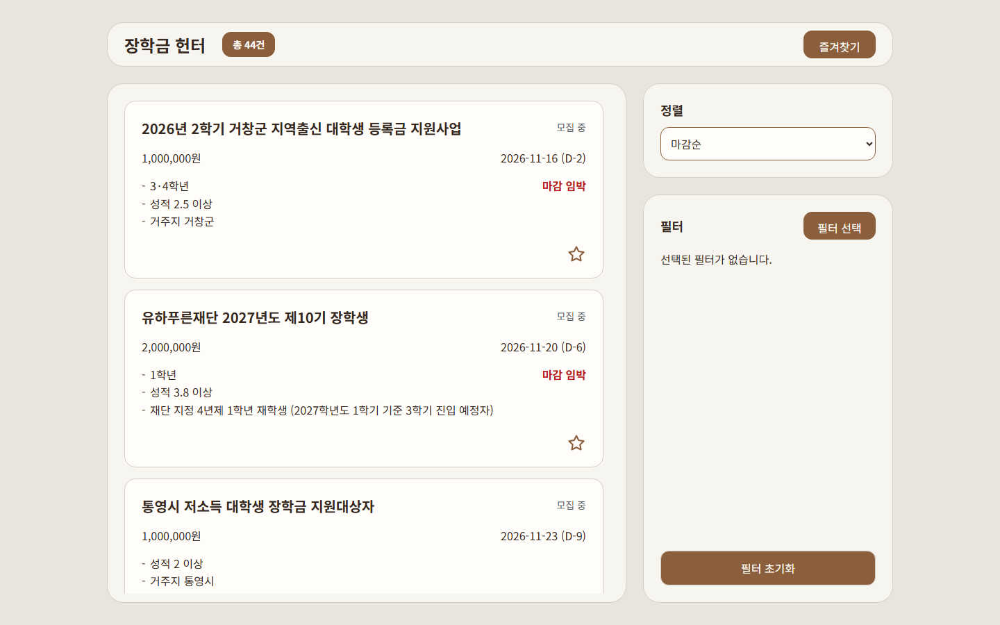
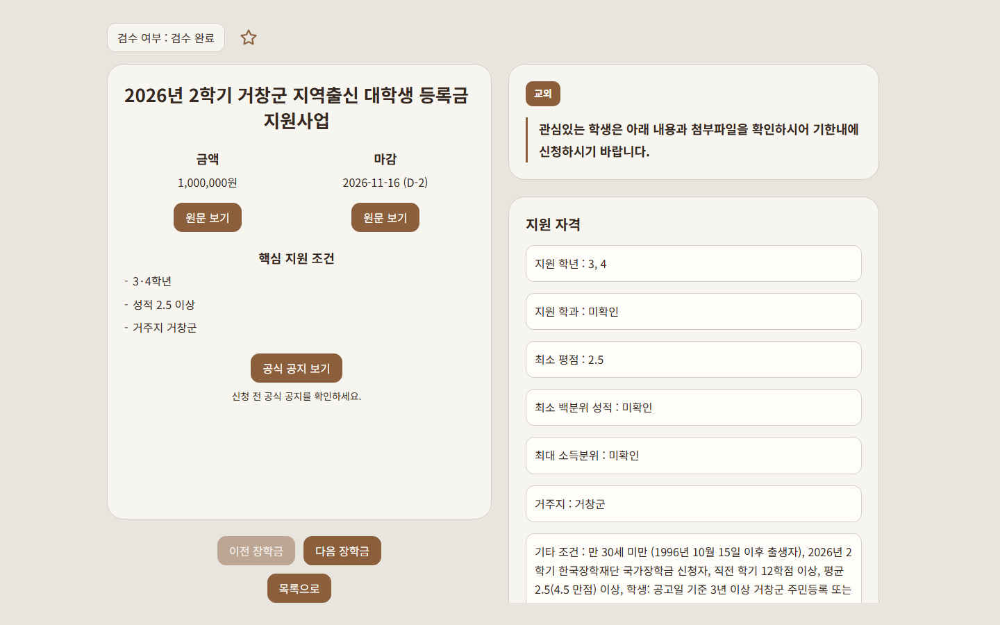
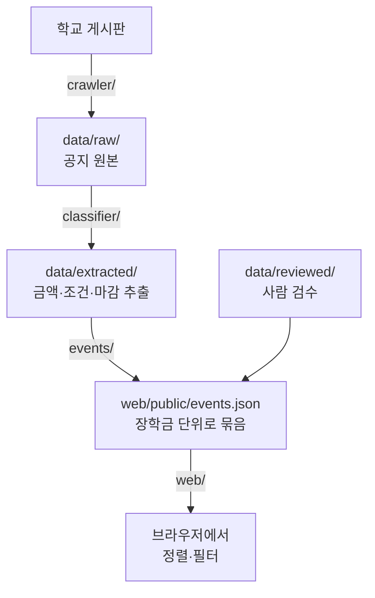

# 장학금 헌터

서울과학기술대학교 교내 게시판(본부·학과)에 흩어진 **장학금 공지를 한곳에 모아, 금액·조건·마감을 비교**할 수 있게 해 주는 웹 서비스입니다.

ENDPoinT 해커톤 2026 Team 17

| 장학금 목록 | 장학금 상세 |
|---|---|
|  |  |

## 왜 만들었나

장학금 공지는 본부 장학공지 게시판 한 곳에만 올라오지 않습니다. 2026-10-14 ~ 11-13 한 달 동안 직접 세어 본 결과입니다.

| 문제 | 실측 |
|---|---|
| 공지가 흩어져 있다 | 장학금 관련 공지 **76건이 31개 게시판**에 올라왔고, 본부 장학공지에는 23건(**30%**)뿐이었습니다 |
| 학과 게시판에만 올라오는 장학금이 있다 | 전기정보공학과, 안전공학과, 건축공학전공 게시판에만 올라온 장학금이 있었습니다 |
| 같은 공지가 여러 번 올라온다 | 한 장학금 공지가 학과 8곳 이상에 다시 올라왔습니다 |
| 금액을 비교하기 어렵다 | 본문에 금액이 적힌 공지는 **24%**이고, **80%**는 첨부 파일(HWP·PDF)을 열어야 합니다 |

자기 학과 게시판만 보는 학생은 받을 수 있는 장학금을 놓치기 쉽고, 여러 게시판을 다 보는 학생은 같은 공지를 반복해서 읽게 됩니다. 근거 자료는 [docs/scholarship-mvp.md](docs/scholarship-mvp.md)와 [docs/research-findings.md](docs/research-findings.md)에 있습니다.

## 할 수 있는 것

- **한 목록에서 보기**: 여러 게시판의 장학금을 카드 하나씩으로 봅니다. 카드에는 장학금 이름, 금액, 마감일(D-day), 핵심 지원 조건이 나오고, 마감이 7일 안으로 남으면 **마감 임박**이 표시됩니다.
- **같은 장학금은 하나로**: 모집 공지, 기한 연장, 마감·결과 공지처럼 같은 장학금에 대한 글은 카드 하나로 묶입니다. 여러 학과에 다시 올라온 글도 한 번만 나옵니다.
- **정렬**: 마감이 가까운 순, 금액이 큰 순. 금액순은 일시금 / 등록금 비율 / 시급 중 같은 종류끼리만 비교합니다.
- **필터**: 유형(교내 / 교외 / 근로), 학년, 학과(여러 개 선택 가능), 모집 중만 보기.
- **상세 보기**: 지원 자격, 제출 서류와 면접 여부, 중복 수혜 제한을 확인하고 관련 공지 원문으로 이동합니다.
- **즐겨찾기**: 카드의 별을 눌러 관심 있는 장학금을 모아 두고, 즐겨찾기 화면에서 따로 봅니다.

## 쓰는 법

1. 첫 화면에 장학금 목록이 마감이 가까운 순으로 나옵니다.
2. 오른쪽 **필터 선택**을 눌러 유형·학년·학과를 고르고 **적용**을 누릅니다. 적용된 필터는 오른쪽에 표시되고, `×`를 누르면 바로 해제됩니다.
3. 오른쪽 **정렬**에서 마감순 / 금액순을 바꿉니다. 금액순을 고르면 금액 종류를 하나 선택합니다.
4. 카드를 누르면 상세 화면으로 갑니다. **공식 공지 보기**를 누르면 그 장학금의 공지 목록이 나오고, 공지를 누르면 학교 게시판 원문이 새 탭에서 열립니다.
5. 카드나 상세 화면의 별(☆)을 누르면 즐겨찾기에 들어갑니다. 위쪽 **즐겨찾기** 버튼을 누르면 모아 둔 장학금만 볼 수 있습니다.

### 알아 둘 점

- **신청 전에 반드시 공식 공지를 확인하세요.** 금액·조건·마감은 공지에서 자동으로 뽑은 뒤 팀원이 확인한 값이며, 틀릴 수 있습니다. 상세 화면에 검수 여부가 표시됩니다.
- 확인되지 않은 값은 **미확인**으로 표시합니다. 학년이나 학과 필터를 켜면 그 조건이 미확인인 장학금은 목록에서 빠집니다.
- 마감 시각은 다루지 않고 날짜만 봅니다. 마감일 당일까지 모집 중으로 표시합니다.
- 공지는 자동으로 갱신되지 않습니다. 팀이 수집을 돌린 시점까지의 공지가 들어 있습니다.
- PC 화면 기준으로 만들었습니다. 모바일 화면은 아직 지원하지 않습니다.

## 개인정보

- 회원가입과 로그인이 없습니다. 고른 학년·학과 같은 필터 값과 즐겨찾기는 **브라우저 안에만** 저장되고 서버로 보내지 않습니다. 필터 값은 탭을 닫으면 지워지고, 즐겨찾기는 그 브라우저에 남습니다.
- 공지 본문 전체나 첨부 파일을 다시 게시하지 않습니다. 요약과 원문 링크만 보여 줍니다.
- 공지에 있는 이름 명단, 이메일 주소, 전화번호는 수집 단계에서 자동으로 지우고, 자동으로 못 잡은 것은 검수할 때 확인합니다. 선발 결과 공지의 첨부는 명단이 들어 있을 수 있어 읽지 않습니다.

## 실행해 보기

아직 배포 주소가 없어 저장소를 받아 직접 엽니다. [uv](https://docs.astral.sh/uv/)가 필요합니다.

```bash
uv run python -m http.server 8000 --directory web
```

브라우저에서 <http://localhost:8000>을 엽니다. 수집된 데이터(`web/public/events.json`)가 저장소에 들어 있어서 학교 서버에 접속하지 않고 볼 수 있습니다.

## 어떻게 동작하나

서버와 DB 없이, Python 스크립트가 JSON 파일을 만들고 정적 웹 화면이 그 파일을 읽습니다.



| 단계 | 폴더 | 하는 일 |
|---|---|---|
| 수집 | `crawler/` | 게시판에서 장학금 공지를 모으고, 첨부(PDF·HWP 등)에서 텍스트만 뽑습니다. 내용이 같은 재게시 글을 표시합니다 |
| 분류 | `classifier/` | 공지마다 유형·금액·조건·마감을 뽑고 모집 / 수정 / 완료로 나눕니다 |
| 검수 | `data/reviewed/` | 자동으로 뽑은 값이 틀리면 사람이 고쳐 덮어씁니다 |
| 이벤트 묶기 | `events/` | 같은 장학금의 공지들을 하나로 묶어 화면용 파일을 만듭니다 |
| 화면 | `web/` | 파일을 읽어 브라우저에서 정렬·필터합니다 (Vite 없이도 열리는 순수 JavaScript) |

## 다음 단계

마감 알림, 예약 자동 수집, 가성비(금액 ÷ 준비 부담) 정렬, 모바일 화면은 아직 만들지 않았습니다.

## 개발자용 문서

- [docs/development.md](docs/development.md): 개발 환경 설치, 명령, 폴더
- [AGENTS.md](AGENTS.md): 팀·AI 공통 규칙, 기술 스택 결정
- [docs/scholarship-mvp.md](docs/scholarship-mvp.md): 서비스 범위와 데이터 흐름
- [docs/project-risks.md](docs/project-risks.md): 위험 요소와 대응
